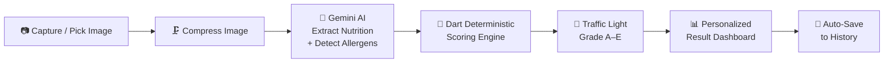

<p align="center">
  
  
  
  
  
</p>

<h1 align="center">🔬 NutriScan AI</h1>

<p align="center">
  <strong>Your Personal AI-Powered Food Label Scanner</strong><br/>
  <em>Scan. Understand. Eat Smarter.</em>
</p>

<p align="center">
  Snap a photo of any food label and get an instant, <strong>personalized health assessment</strong> tailored to your medical conditions, allergies, and dietary preferences — powered by Google Gemini AI with deterministic nutritional scoring.
</p>

---

## ✨ Key Features

### 🤖 AI-Powered Label Analysis
- Extracts nutrition facts (sugar, sodium, saturated fat, calories) from food packaging images using **Google Gemini 3.5 Flash Lite** via Firebase AI.
- Detects **hidden sugars** (maltodextrin, HFCS, dextrose), **hidden sodium** (MSG, disodium), and risky additives automatically.
- Supports both camera capture and gallery image selection with automatic image compression for fast processing.

### 🧑‍⚕️ Deep Personalization
- **5-step onboarding wizard** collects your health profile: name, age, gender, height, weight, health conditions, allergies, and diet preferences.
- AI analysis is dynamically tailored based on your unique health persona — a diabetic user receives stricter sugar thresholds; a hypertension patient gets tighter sodium limits.
- Profile data is persisted locally via SharedPreferences for seamless re-use.

### 🚦 Deterministic Traffic Light & Grade Scoring
- **Not a black-box AI guess** — final health scores (A–E grades + GREEN/YELLOW/RED traffic light) are computed **deterministically in Dart**, not by the LLM.
- Daily limit percentages for sugar, sodium, and saturated fat are calculated against configurable country standards, then adjusted for the user's medical conditions:

| Condition | Adjustment |
|---|---|
| Diabetes | Sugar limit halved to 25g |
| Hypertension / Kidney Disease | Sodium limit tightened to 1500mg |
| Cholesterol / Heart Disease | Saturated fat limit tightened to 13g |

### 🌍 Multi-Country Nutrition Standards
| Standard | Sugar (g) | Sodium (mg) | Sat. Fat (g) |
|---|---|---|---|
| 🇮🇩 Indonesia (BPOM) | 50 | 2000 | 20 |
| 🌐 WHO Global | 25 | 2000 | 20 |
| 🇸🇬 Singapore (HPB) | 40 | 2000 | 20 |
| 🇺🇸 USA (FDA) | 50 | 2300 | 20 |

### ⚠️ Allergen & Diet Compliance Alerts
- Cross-references detected allergens against your personal allergy list (supports Seafood, Dairy/Lactose, Peanuts, Eggs, Gluten, and custom entries).
- Checks compliance with diet preferences (Halal, Vegetarian, Vegan, or custom diets).
- Displays clear **ALLERGEN ALERT** or **DIET WARNING** banners when conflicts are detected.

### 📊 Smart Results Dashboard
- Large grade badge (A–E) with color-coded traffic light indicator.
- Per-serving vs. per-container toggle to see the real nutritional impact of eating the whole package.
- Visual progress bars showing how much of your daily limit each nutrient consumes.
- Hidden ingredients section exposing sneaky additives in plain language.
- AI confidence score displayed for transparency.

### 📜 Scan History
- Every scan is automatically saved locally.
- Browse past results from the home screen with grade badges and quick nutrient summaries.
- Tap any history item to view the full result detail.
- Option to clear scan history.

### 🌐 Multilingual AI Explanations
- AI summaries, diet notes, and hidden ingredient descriptions can be generated in **English** or **Bahasa Indonesia** based on your preference.

---

## 🏗️ Architecture

```
lib/
├── main.dart                      # App entry point, Firebase init, camera init
├── firebase_options.dart          # Firebase configuration (auto-generated)
│
├── model/
│   └── user_model.dart            # UserModel + ScanResultModel + deterministic scoring engine
│
├── data/
│   ├── services/
│   │   ├── gemini_service.dart     # Firebase AI (Gemini) integration & prompt engineering
│   │   └── storage_service.dart   # SharedPreferences persistence for user & scan history
│   ├── models/                    # Data transfer objects
│   └── prompts/                   # AI prompt templates
│
├── domain/
│   └── scoring/                   # Scoring domain logic
│
├── features/
│   ├── history/                   # Scan history feature module
│   ├── persona/                   # Health persona feature module
│   ├── result/                    # Scan result feature module
│   └── scan/                      # Camera scan feature module
│
├── view/
│   ├── wizard_view.dart           # 5-step personalization onboarding
│   ├── main_layout.dart           # Bottom navigation shell (Home, Scan FAB, Profile)
│   ├── home_view.dart             # Dashboard with BMI, scan button, & history list
│   ├── scan_view.dart             # Camera viewfinder with flash/gallery/switch controls
│   ├── result_view.dart           # Comprehensive scan result display
│   └── profile_view.dart          # Editable health persona settings
│
└── core/                          # Shared utilities & constants
```

### How It Works



1. **Image Capture** — User takes a photo or picks from gallery.  
2. **Compression** — Image is compressed to 70% quality (max 1024px) for fast upload.  
3. **AI Extraction** — Gemini AI parses the nutrition label and ingredients, detecting allergens and hidden additives based on the user's health profile.  
4. **Deterministic Scoring** — Dart code independently calculates daily limit percentages, matches allergens, and assigns a traffic light + letter grade. The AI is never trusted for scoring.  
5. **Result Display** — A rich, color-coded dashboard shows the grade, alerts, nutrient bars, and hidden ingredients.  
6. **History** — Result is automatically saved for future reference.

---

## 🚀 Getting Started

### Prerequisites

- **Flutter SDK** ≥ 3.x (Dart SDK ≥ 3.11)
- **Android Studio** or **VS Code** with Flutter extension
- A **Firebase project** with Firebase AI (Vertex AI / Gemini) enabled
- An Android device or emulator (camera features require a physical device)

### Installation

1. **Clone the repository**
   ```bash
   git clone https://github.com/Khalil-r-Abbas/food-lable-scanner.git
   cd food-lable-scanner
   ```

2. **Install dependencies**
   ```bash
   flutter pub get
   ```

3. **Configure Firebase**
   - Create a Firebase project at [console.firebase.google.com](https://console.firebase.google.com)
   - Enable **Firebase AI** (Gemini API) in your project
   - Download your `google-services.json` and place it in `android/app/`
   - The `firebase_options.dart` is already configured — update it if using a different Firebase project:
     ```bash
     flutterfire configure
     ```

4. **Run the app**
   ```bash
   flutter run
   ```

### Build for Release

```bash
flutter build apk --release
```

---

## 📦 Dependencies

| Package | Purpose |
|---|---|
| `firebase_core` | Firebase initialization |
| `firebase_ai` | Google Gemini AI (via Firebase) for image analysis |
| `camera` | Live camera viewfinder and capture |
| `image_picker` | Gallery image selection |
| `flutter_image_compress` | Image compression before AI processing |
| `shared_preferences` | Local persistence for user profile & scan history |
| `json_annotation` + `json_serializable` | JSON serialization for data models |

---

## 🎯 What Makes NutriScan AI Unique?

| Feature | NutriScan AI | Typical Scanner Apps |
|---|---|---|
| Personalized to your health profile | ✅ | ❌ |
| Adjusts limits per medical condition | ✅ | ❌ |
| Multi-country nutrition standards | ✅ (BPOM, WHO, HPB, FDA) | ❌ Single standard |
| Deterministic scoring (not AI guessing) | ✅ Dart-calculated | ❌ LLM-dependent |
| Hidden ingredient detection | ✅ | ❌ |
| Allergen cross-matching | ✅ User-specific | ⚠️ Generic only |
| Per-serving vs per-container toggle | ✅ | ❌ |
| No barcode database dependency | ✅ Works with any label photo | ❌ Requires barcode match |

---

## 📄 License

This project is open-source and available under the [MIT License](LICENSE).

---

<p align="center">
  Made with ❤️ and Flutter<br/>
  <strong>NutriScan AI</strong> — Because what you eat should be informed by who you are.
</p>
